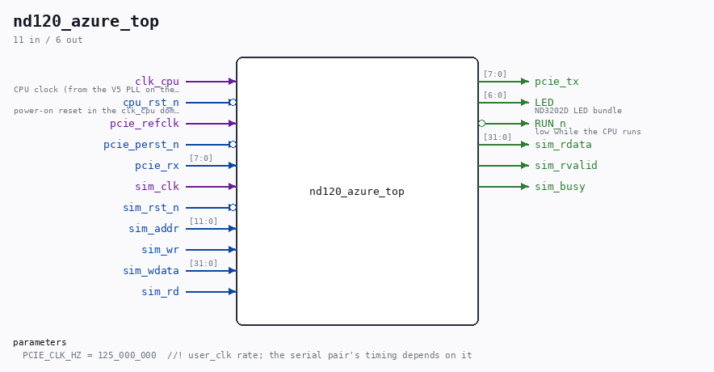
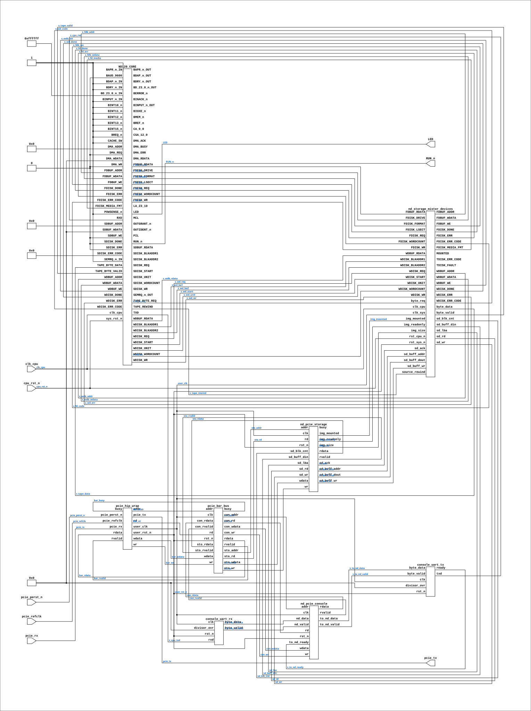

# nd120_azure_top

Source: `Verilog/fpga/azure-x930613/rtl/nd120_azure_top.v`

<!-- Generated by Verilog/tests/module_doc.py from the //! comments in the source. Do not edit by hand - edit the RTL comments and regenerate. -->

<!-- HIERARCHY-NAV:BEGIN - written by Verilog/tests/gen_hierarchy.py, do not edit -->

**Where it sits** (Azure): **nd120_azure_top**

**Used in:** nothing - this is a top (Azure).

**Contains:** [console_uart_rx](../../../../Terminals/rtl/doc/console_uart_rx.md), [console_uart_tx](../../../../Terminals/rtl/doc/console_uart_tx.md), [ND120_CORE](../../../../doc/ND120_CORE.md), [nd_pcie_console](nd_pcie_console.md), [nd_pcie_storage](nd_pcie_storage.md), [nd_storage_mister_devices](../../../mister/rtl/doc/nd_storage_mister_devices.md), [pcie_bar_bus](pcie_bar_bus.md), [pcie_hip_wrap](pcie_hip_wrap.md)

[Module hierarchy](../../../../HIERARCHY.md) - [All modules](../../../../MODULES.md)

<!-- HIERARCHY-NAV:END -->



<!-- SCHEMATIC:BEGIN - written by Verilog/tests/gen_schematics.py, do not edit -->

## Schematic

Drawn from the Verilog: the yosys netlist of the Azure card X930613 build, where it is the top. Sub-modules are boxes (click the picture to open it full size; there every sub-module box links to its page, and every wire shows its Verilog name).

[](nd120_azure_top.svg)

<!-- SCHEMATIC:END -->

## Parameters

| Parameter | Default |
|---|---|
| `PCIE_CLK_HZ` | `125_000_000  //! user_clk rate; the serial pair's timing depends on it` |

## Ports

| Direction | Width | Name | Description |
|---|---|---|---|
| input | `1` | `clk_cpu` | CPU clock (from the V5 PLL on the card; from the harness in simulation) |
| input | `1` | `cpu_rst_n` *(active low)* | power-on reset in the clk_cpu domain, active low |
| input | `1` | `pcie_refclk` |  |
| input | `1` | `pcie_perst_n` *(active low)* |  |
| input | `[7:0]` | `pcie_rx` |  |
| output | `[7:0]` | `pcie_tx` |  |
| output | `[6:0]` | `LED` | ND3202D LED bundle |
| output | `1` | `RUN_n` *(active low)* | low while the CPU runs |
| input | `1` | `sim_clk` |  |
| input | `1` | `sim_rst_n` *(active low)* |  |
| input | `[11:0]` | `sim_addr` |  |
| input | `1` | `sim_wr` |  |
| input | `[31:0]` | `sim_wdata` |  |
| input | `1` | `sim_rd` |  |
| output | `[31:0]` | `sim_rdata` |  |
| output | `1` | `sim_rvalid` |  |
| output | `1` | `sim_busy` |  |

## Verilog source

[`Verilog/fpga/azure-x930613/rtl/nd120_azure_top.v`](https://github.com/RetroCoreLabs/nd-120/blob/main/Verilog/fpga/azure-x930613/rtl/nd120_azure_top.v) on GitHub.

<details markdown="1">
<summary>Show the Verilog of nd120_azure_top (451 lines)</summary>

```verilog
//============================================================================
//! nd120_azure_top - the ND-120 on the Microsoft Azure FPGA card (X930613-001)
//!
//! Board folder: Verilog/fpga/azure-x930613 (plan: docs/00-plan.md, step V4).
//!
//! WHAT IS IN IT
//!   - ND120_CORE, the shared CPU + 3202D board, unchanged, with the same
//!     devices as the Nexys and MiSTer (tape, floppy, Winchester).
//!   - Main memory: 2 MB in block RAM, ONE bank of 1M words. The board is
//!     built as the real 2 MB variant of the 3202D (ND120_ONBOARD_2MB, see
//!     PAL_44446B.v / PAL_44445B.v): above 2 MB it does not answer, so the
//!     machine is never shown memory that is not there. The 2 MB address
//!     decode is DERIVED, not taken from a PAL dump - see those files.
//!   - Console over PCIe: the CPU's own SC2661 serial port, deserialised by
//!     console_uart_rx and fed by console_uart_tx (the pair every board
//!     uses), behind nd_pcie_console's two byte queues.
//!   - Disks served by the PC: the MiSTer's storage devices
//!     (nd_storage_mister_devices -> nd_storage_hps), unchanged, driven by
//!     nd_pcie_storage instead of the MiSTer's ARM side.
//!   - pcie_bar_bus splits the one 4 KB PCIe window (console 0o0000, disks
//!     0o1000); pcie_hip_wrap is the PCIe hard block (simulation version
//!     only until step V5 - a real-card build stops at its missing module).
//!
//! REQUIRED DEFINES (the build, or the Verilator script, sets them):
//!   MAIN_RAM_BLOCKRAM, ND120_BLOCKRAM_ADDR_BITS=20,
//!   ND120_BLOCKRAM_BANK_SLOTS=1, ND120_ONBOARD_2MB, FPGA_FF_MODE,
//!   BOARD_CLK_FREQ=<clk_cpu in Hz>, UART_BAUD_RATE=115200.
//!   ND120_AZURE_SIM_PCIE for simulation (brings out the sim_* ports).
//! The checks below stop a build that forgets the memory ones: a block-RAM
//! bank smaller than the 1M words the 2 MB decode answers for would wrap
//! high addresses onto low memory.
//!
//! CLOCKS
//!   clk_cpu   CPU, bus and device domain. On the real card it will come
//!             from a PLL off the card's 125 MHz oscillator (pin and PLL are
//!             step V5 work, not done); here it is an input.
//!   user_clk  the PCIe side (from pcie_hip_wrap). The console's serial pair
//!             and both PCIe blocks run on it; nd_storage_hps carries the
//!             disk traffic across to clk_cpu itself, and the serial lines are
//!             the only other crossing (console_uart_rx resynchronises).
//!             PCIE_CLK_HZ must match it - the serial pair's bit timing is
//!             derived from it.
//============================================================================

`default_nettype none

module nd120_azure_top #(
    parameter integer PCIE_CLK_HZ = 125_000_000  //! user_clk rate; the serial pair's timing depends on it
) (
    input  wire       clk_cpu,       //! CPU clock (from the V5 PLL on the card; from the harness in simulation)
    input  wire       cpu_rst_n,     //! power-on reset in the clk_cpu domain, active low

    // ---- PCIe pins (unused in simulation) ----
    input  wire       pcie_refclk,
    input  wire       pcie_perst_n,
    input  wire [7:0] pcie_rx,
    output wire [7:0] pcie_tx,

    // ---- status ----
    output wire [6:0] LED,           //! ND3202D LED bundle
    output wire       RUN_n          //! low while the CPU runs

`ifdef ND120_AZURE_SIM_PCIE
    ,
    // ---- simulation only: the PC, played by the harness (see pcie_hip_wrap) ----
    input  wire        sim_clk,
    input  wire        sim_rst_n,
    input  wire [11:0] sim_addr,
    input  wire        sim_wr,
    input  wire [31:0] sim_wdata,
    input  wire        sim_rd,
    output wire [31:0] sim_rdata,
    output wire        sim_rvalid,
    output wire        sim_busy
`endif
);

  // A build that forgets a memory define must not elaborate. Each missing
  // define instantiates a module that does not exist, so every tool
  // (Verilator, iverilog, Quartus) stops and names the problem.
`ifndef MAIN_RAM_BLOCKRAM
  AZURE_NEEDS_DEFINE_MAIN_RAM_BLOCKRAM missing_define_1 ();
`endif
`ifndef ND120_ONBOARD_2MB
  AZURE_NEEDS_DEFINE_ND120_ONBOARD_2MB missing_define_2 ();
`endif
`ifndef ND120_BLOCKRAM_ADDR_BITS
  AZURE_NEEDS_DEFINE_ND120_BLOCKRAM_ADDR_BITS_20 missing_define_3 ();
  `define ND120_BLOCKRAM_ADDR_BITS 0
`endif

  // block-RAM bank must hold everything the 2 MB decode answers for
  generate
    if (`ND120_BLOCKRAM_ADDR_BITS < 20) begin : g_ram_too_small
      initial $fatal(1, "nd120_azure_top: ND120_BLOCKRAM_ADDR_BITS=%0d < 20 - high addresses would wrap",
                     `ND120_BLOCKRAM_ADDR_BITS);
    end
  endgenerate

  //==========================================================================
  // PCIe: hard block -> window split
  //==========================================================================
  wire        user_clk, user_rst_n;
  wire [11:0] bar_addr;
  wire        bar_wr, bar_rd, bar_rvalid, bar_busy;
  wire [31:0] bar_wdata, bar_rdata;

  pcie_hip_wrap HIP (
      .pcie_refclk (pcie_refclk),
      .pcie_perst_n(pcie_perst_n),
      .pcie_rx     (pcie_rx),
      .pcie_tx     (pcie_tx),
      .user_clk    (user_clk),
      .user_rst_n  (user_rst_n),
      .addr        (bar_addr),
      .wr          (bar_wr),
      .wdata       (bar_wdata),
      .rd          (bar_rd),
      .rdata       (bar_rdata),
      .rvalid      (bar_rvalid),
      .busy        (bar_busy)
`ifdef ND120_AZURE_SIM_PCIE
      ,
      .sim_clk   (sim_clk),
      .sim_rst_n (sim_rst_n),
      .sim_addr  (sim_addr),
      .sim_wr    (sim_wr),
      .sim_wdata (sim_wdata),
      .sim_rd    (sim_rd),
      .sim_rdata (sim_rdata),
      .sim_rvalid(sim_rvalid),
      .sim_busy  (sim_busy)
`endif
  );

  wire [8:0]  con_addr, sto_addr;
  wire        con_wr, con_rd, con_rvalid, sto_wr, sto_rd, sto_rvalid, sto_busy;
  wire [31:0] con_wdata, con_rdata, sto_wdata, sto_rdata;

  pcie_bar_bus BAR (
      .clk       (user_clk),
      .rst_n     (user_rst_n),
      .addr      (bar_addr),
      .wr        (bar_wr),
      .wdata     (bar_wdata),
      .rd        (bar_rd),
      .rdata     (bar_rdata),
      .rvalid    (bar_rvalid),
      .busy      (bar_busy),
      .con_addr  (con_addr),
      .con_wr    (con_wr),
      .con_wdata (con_wdata),
      .con_rd    (con_rd),
      .con_rdata (con_rdata),
      .con_rvalid(con_rvalid),
      .sto_addr  (sto_addr),
      .sto_wr    (sto_wr),
      .sto_wdata (sto_wdata),
      .sto_rd    (sto_rd),
      .sto_rdata (sto_rdata),
      .sto_rvalid(sto_rvalid)
  );

  //==========================================================================
  // Console: CPU serial port <-> serial pair <-> PCIe byte queues
  //==========================================================================
  wire       s_cpu_txd, s_cpu_rxd;
  wire       s_from_nd_valid;
  wire [7:0] s_from_nd_data;
  wire       s_to_nd_valid, s_to_nd_ready;
  wire [7:0] s_to_nd_data;

  // 7 data bits + parity on the CPU's TXD line, 8N1 into its RXD - the
  // MiSTer's and the Nexys's settings, and the reason is the same: SINTRAN
  // puts SOFTWARE parity in bit 7 of its boot text, and a 7E1 receiver drops
  // it (see the long note at console_uart_rx in fpga/mister/nd120.sv).
  console_uart_rx #(
      .CLK_HZ   (PCIE_CLK_HZ),
      .BAUD     (115_200),
      .DATA_BITS(7),
      .PARITY   (1'b1)
  ) CONSOLE_UART_RX (
      .clk        (user_clk),
      .rst_n      (user_rst_n),
      .divisor_ovr(16'd0),
      .rxd        (s_cpu_txd),
      .byte_valid (s_from_nd_valid),
      .byte_data  (s_from_nd_data)
  );

  console_uart_tx #(
      .CLK_HZ    (PCIE_CLK_HZ),
      .BAUD      (115_200),
      .DATA_BITS (8),
      .PARITY    (1'b0),
      .PARITY_ODD(1'b0)
  ) CONSOLE_UART_TX (
      .clk        (user_clk),
      .rst_n      (user_rst_n),
      .divisor_ovr(16'd0),
      .byte_valid (s_to_nd_valid),
      .byte_data  (s_to_nd_data),
      .ready      (s_to_nd_ready),
      .txd        (s_cpu_rxd)
  );

  nd_pcie_console CONSOLE (
      .clk        (user_clk),
      .rst_n      (user_rst_n),
      .addr       (con_addr),
      .wr         (con_wr),
      .wdata      (con_wdata),
      .rd         (con_rd),
      .rdata      (con_rdata),
      .rvalid     (con_rvalid),
      .nd_valid   (s_from_nd_valid),
      .nd_data    (s_from_nd_data),
      .to_nd_valid(s_to_nd_valid),
      .to_nd_data (s_to_nd_data),
      .to_nd_ready(s_to_nd_ready)
  );

  //==========================================================================
  // Disks: ND controllers <-> MiSTer storage devices <-> PCIe disk block
  //==========================================================================
  wire        s_tape_req, s_tape_valid, s_tape_rewind;
  wire [7:0]  s_tape_data;
  wire        s_tdisk_fault;
  wire [3:0]  s_tdisk_code;
  wire        s_fd_req, s_fd_wr, s_fd_done, s_fd_err, s_fdb_we;
  wire [15:0] s_fd_lsect, s_fdb_wdata, s_fdb_rdata;
  wire [1:0]  s_fd_format, s_fd_drive;
  wire [10:0] s_fd_wc;
  wire [3:0]  s_fd_code, s_fd_media;
  wire [9:0]  s_fdb_addr;
  wire        s_wd_start, s_wd_req, s_wd_wr, s_wd_done, s_wd_err, s_wdb_we;
  wire [15:0] s_wd_ba1, s_wd_ba2, s_wdb_wdata, s_wdb_rdata;
  wire [2:0]  s_wd_unit;
  wire [10:0] s_wd_wc;
  wire [3:0]  s_wd_code;
  wire [9:0]  s_wdb_addr;

  wire [4:0]     img_mounted, sd_rd, sd_wr, sd_ack;
  wire           img_readonly, sd_buff_wr;
  wire [63:0]    img_size;
  wire [5*32-1:0] sd_lba;
  wire [5*6-1:0]  sd_blk_cnt;
  wire [12:0]    sd_buff_addr;
  wire [15:0]    sd_buff_dout, sd_buff_din;

  // slot n = one image file on the PC; which slot is which drive is set in
  // nd_storage_mister_devices.v (the MiSTer's OSD order)
  nd_storage_mister_devices STORAGE (
      .clk_cpu   (clk_cpu),
      .rst_cpu_n (cpu_rst_n),
      .clk_sys   (user_clk),
      .rst_sys_n (user_rst_n),

      .byte_req      (s_tape_req),
      .byte_valid    (s_tape_valid),
      .byte_data     (s_tape_data),
      .source_rewind (s_tape_rewind),
      .TDISK_FAULT   (s_tdisk_fault),
      .TDISK_ERR_CODE(s_tdisk_code),

      .FDISK_REQ      (s_fd_req),
      .FDISK_WR       (s_fd_wr),
      .FDISK_LSECT    (s_fd_lsect),
      .FDISK_FORMAT   (s_fd_format),
      .FDISK_DRIVE    (s_fd_drive),
      .FDISK_WORDCOUNT(s_fd_wc),
      .FDISK_DONE     (s_fd_done),
      .FDISK_ERR      (s_fd_err),
      .FDISK_ERR_CODE (s_fd_code),
      .FDISK_MEDIA_FMT(s_fd_media),
      .FDBUF_ADDR     (s_fdb_addr),
      .FDBUF_WDATA    (s_fdb_wdata),
      .FDBUF_WE       (s_fdb_we),
      .FDBUF_RDATA    (s_fdb_rdata),

      .WDISK_START    (s_wd_start),
      .WDISK_REQ      (s_wd_req),
      .WDISK_WR       (s_wd_wr),
      .WDISK_BLKADDR1 (s_wd_ba1),
      .WDISK_BLKADDR2 (s_wd_ba2),
      .WDISK_UNIT     (s_wd_unit),
      .WDISK_WORDCOUNT(s_wd_wc),
      .WDISK_DONE     (s_wd_done),
      .WDISK_ERR      (s_wd_err),
      .WDISK_ERR_CODE (s_wd_code),
      .WDBUF_ADDR     (s_wdb_addr),
      .WDBUF_WDATA    (s_wdb_wdata),
      .WDBUF_WE       (s_wdb_we),
      .WDBUF_RDATA    (s_wdb_rdata),

      .img_mounted (img_mounted),
      .img_readonly(img_readonly),
      .img_size    (img_size),
      .sd_lba      (sd_lba),
      .sd_blk_cnt  (sd_blk_cnt),
      .sd_rd       (sd_rd),
      .sd_wr       (sd_wr),
      .sd_ack      (sd_ack),
      .sd_buff_addr(sd_buff_addr),
      .sd_buff_dout(sd_buff_dout),
      .sd_buff_din (sd_buff_din),
      .sd_buff_wr  (sd_buff_wr),

      .MOUNTED()
  );

  nd_pcie_storage #(.N_SLOTS(5)) DISKS (
      .clk         (user_clk),
      .rst_n       (user_rst_n),
      .addr        (sto_addr),
      .wr          (sto_wr),
      .wdata       (sto_wdata),
      .rd          (sto_rd),
      .rdata       (sto_rdata),
      .rvalid      (sto_rvalid),
      .busy        (sto_busy),
      .img_mounted (img_mounted),
      .img_readonly(img_readonly),
      .img_size    (img_size),
      .sd_lba      (sd_lba),
      .sd_blk_cnt  (sd_blk_cnt),
      .sd_rd       (sd_rd),
      .sd_wr       (sd_wr),
      .sd_ack      (sd_ack),
      .sd_buff_addr(sd_buff_addr),
      .sd_buff_dout(sd_buff_dout),
      .sd_buff_din (sd_buff_din),
      .sd_buff_wr  (sd_buff_wr)
  );

  //==========================================================================
  // The ND-120: CPU + 3202D board, devices as on the Nexys and MiSTer
  //==========================================================================
  ND120_CORE #(
      .INCLUDE_TAPE  (1),
      .INCLUDE_FLOPPY(1),
      .INCLUDE_SMD   (0),
      .INCLUDE_WD    (1)
  ) CORE (
      .BAUD_9600(1'b0),     // console fixed at 115200
      .clk_cpu  (clk_cpu),
      .sys_rst_n(cpu_rst_n),
      .CACHE_SW (1'b1),     // cache on, as on every booting board

      // no external ND bus on this card (same tie-off as the Tang and MiSTer)
      .BREQ_n    (1'b1),
      .BINT10_n  (1'b1),
      .BINT11_n  (1'b1),
      .BINT12_n  (1'b1),
      .BINT13_n  (1'b1),
      .BINT15_n  (1'b1),
      .POWSENSE_n(1'b1),
      .BD_23_0_n_IN (24'hFFFFFF),
      .BD_23_0_n_OUT(),
      .SEMRQ_n_IN (1'b1),
      .SEMRQ_n_OUT(),
      .BINPUT_n_IN (1'b1),
      .BINPUT_n_OUT(),
      .BDAP_n_IN (1'b1),
      .BDAP_n_OUT(),
      .BDRY_n_IN (1'b1),
      .BDRY_n_OUT(),
      .BAPR_n_IN (1'b1),
      .BAPR_n_OUT(),
      .BREF_n    (),
      .BERROR_n  (),
      .BINACK_n  (),
      .BIOXE_n   (),
      .BMEM_n    (),
      .OUTGRANT_n(),
      .OUTIDENT_n(),
      .MCL       (),

      .RXD(s_cpu_rxd),
      .TXD(s_cpu_txd),

      .TAPE_BYTE_REQ  (s_tape_req),
      .TAPE_BYTE_VALID(s_tape_valid),
      .TAPE_BYTE_DATA (s_tape_data),
      .TAPE_REWIND    (s_tape_rewind),

      .DMA_REQ  (1'b0),
      .DMA_WR   (1'b0),
      .DMA_ADDR (24'd0),
      .DMA_WDATA(16'd0),
      .DMA_RDATA(),
      .DMA_ACK  (),
      .DMA_ERR  (),
      .DMA_BUSY (),

      .FDISK_REQ      (s_fd_req),
      .FDISK_WR       (s_fd_wr),
      .FDISK_LSECT    (s_fd_lsect),
      .FDISK_FORMAT   (s_fd_format),
      .FDISK_DRIVE    (s_fd_drive),
      .FDISK_WORDCOUNT(s_fd_wc),
      .FDISK_DONE     (s_fd_done),
      .FDISK_ERR      (s_fd_err),
      .FDISK_ERR_CODE (s_fd_code),
      .FDISK_MEDIA_FMT(s_fd_media),
      .FDBUF_ADDR     (s_fdb_addr),
      .FDBUF_WDATA    (s_fdb_wdata),
      .FDBUF_WE       (s_fdb_we),
      .FDBUF_RDATA    (s_fdb_rdata),

      .SDISK_START    (),
      .SDISK_REQ      (),
      .SDISK_WR       (),
      .SDISK_BLKADDR1 (),
      .SDISK_BLKADDR2 (),
      .SDISK_UNIT     (),
      .SDISK_WORDCOUNT(),
      .SDISK_DONE     (1'b0),
      .SDISK_ERR      (1'b0),
      .SDISK_ERR_CODE (4'd0),
      .SDBUF_ADDR     (10'd0),
      .SDBUF_WDATA    (16'd0),
      .SDBUF_WE       (1'b0),
      .SDBUF_RDATA    (),

      .WDISK_START    (s_wd_start),
      .WDISK_REQ      (s_wd_req),
      .WDISK_WR       (s_wd_wr),
      .WDISK_BLKADDR1 (s_wd_ba1),
      .WDISK_BLKADDR2 (s_wd_ba2),
      .WDISK_UNIT     (s_wd_unit),
      .WDISK_WORDCOUNT(s_wd_wc),
      .WDISK_DONE     (s_wd_done),
      .WDISK_ERR      (s_wd_err),
      .WDISK_ERR_CODE (s_wd_code),
      .WDBUF_ADDR     (s_wdb_addr),
      .WDBUF_WDATA    (s_wdb_wdata),
      .WDBUF_WE       (s_wdb_we),
      .WDBUF_RDATA    (s_wdb_rdata),

      .LED     (LED),
      .RUN_n   (RUN_n),
      .CSA_12_0(),
      .PIL     (),
      .LA_23_10(),
      .CA_9_0  ()
  );

endmodule

`default_nettype wire
```

</details>
