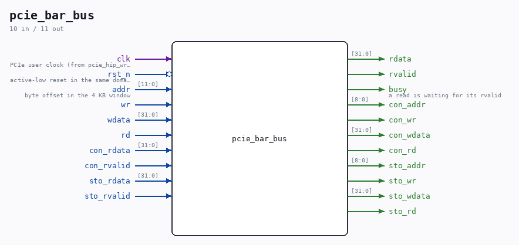
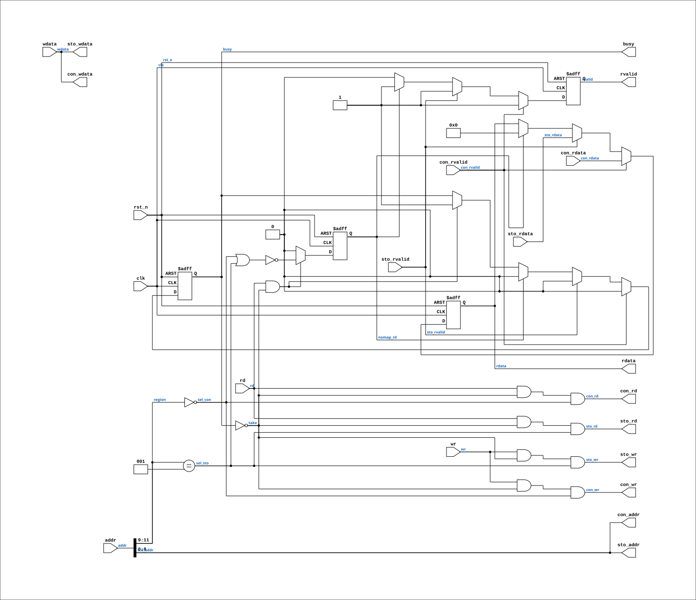

# pcie_bar_bus

Source: `Verilog/fpga/azure-x930613/rtl/pcie_bar_bus.v`

<!-- Generated by Verilog/tests/module_doc.py from the //! comments in the source. Do not edit by hand - edit the RTL comments and regenerate. -->

<!-- HIERARCHY-NAV:BEGIN - written by Verilog/tests/gen_hierarchy.py, do not edit -->

**Where it sits** (Azure): [nd120_azure_top](nd120_azure_top.md) > **pcie_bar_bus**
- instance path: `BAR`

**Used in:** [nd120_azure_top](nd120_azure_top.md) (Azure)

**Contains:** no other modules.

[Module hierarchy](../../../../HIERARCHY.md) - [All modules](../../../../MODULES.md)

<!-- HIERARCHY-NAV:END -->



<!-- SCHEMATIC:BEGIN - written by Verilog/tests/gen_schematics.py, do not edit -->

## Schematic

Drawn from the Verilog: the yosys netlist of the Azure card X930613 build, instance `BAR`. Sub-modules are boxes (click the picture to open it full size; there every sub-module box links to its page, and every wire shows its Verilog name).

[](pcie_bar_bus.svg)

<!-- SCHEMATIC:END -->

## Ports

| Direction | Width | Name | Description |
|---|---|---|---|
| input | `1` | `clk` | PCIe user clock (from pcie_hip_wrap.user_clk) |
| input | `1` | `rst_n` *(active low)* | active-low reset in the same domain |
| input | `[11:0]` | `addr` | byte offset in the 4 KB window |
| input | `1` | `wr` |  |
| input | `[31:0]` | `wdata` |  |
| input | `1` | `rd` |  |
| output | `[31:0]` | `rdata` |  |
| output | `1` | `rvalid` |  |
| output | `1` | `busy` | a read is waiting for its rvalid |
| output | `[8:0]` | `con_addr` |  |
| output | `1` | `con_wr` |  |
| output | `[31:0]` | `con_wdata` |  |
| output | `1` | `con_rd` |  |
| input | `[31:0]` | `con_rdata` |  |
| input | `1` | `con_rvalid` |  |
| output | `[8:0]` | `sto_addr` |  |
| output | `1` | `sto_wr` |  |
| output | `[31:0]` | `sto_wdata` |  |
| output | `1` | `sto_rd` |  |
| input | `[31:0]` | `sto_rdata` |  |
| input | `1` | `sto_rvalid` |  |

## Verilog source

[`Verilog/fpga/azure-x930613/rtl/pcie_bar_bus.v`](https://github.com/RetroCoreLabs/nd-120/blob/main/Verilog/fpga/azure-x930613/rtl/pcie_bar_bus.v) on GitHub.

<details markdown="1">
<summary>Show the Verilog of pcie_bar_bus (104 lines)</summary>

```verilog
//============================================================================
//! pcie_bar_bus - one PCIe register window split between the board blocks
//!
//! Board: Microsoft Azure FPGA card X930613-001 (Verilog/fpga/azure-x930613).
//!
//! The PC sees ONE 4 KB register window (one BAR). This module hands each
//! access to the block that owns that part of the window and brings the
//! answer back (docs/00-plan.md, step V3):
//!
//!   byte offset (octal)   block
//!   0o0000 - 0o0777       nd_pcie_console   (registers in its header)
//!   0o1000 - 0o1777       nd_pcie_storage   (registers in its header)
//!   0o2000 - 0o7777       nothing: reads return 0, writes are ignored
//!
//! THE BUS on both sides is the same one the blocks use: addr = byte offset,
//! 32-bit registers, wr / rd one cycle each, rdata valid while rvalid is
//! high, one access at a time. 'busy' is high from a read until its rvalid,
//! for EVERY block (the storage block's DATA read takes three cycles, the
//! rest one) - the master must hold the next access while busy is high. On
//! the real card the PCIe block's register master has a wait signal and a
//! read-valid signal of its own; pcie_hip_wrap maps them onto this bus.
//============================================================================

`default_nettype none

module pcie_bar_bus (
    input wire clk,    //! PCIe user clock (from pcie_hip_wrap.user_clk)
    input wire rst_n,  //! active-low reset in the same domain

    // ---- from the PCIe side (pcie_hip_wrap) ----
    input  wire [11:0] addr,    //! byte offset in the 4 KB window
    input  wire        wr,
    input  wire [31:0] wdata,
    input  wire        rd,
    output reg  [31:0] rdata,
    output reg         rvalid,
    output wire        busy,    //! a read is waiting for its rvalid

    // ---- to nd_pcie_console ----
    output wire [8:0]  con_addr,
    output wire        con_wr,
    output wire [31:0] con_wdata,
    output wire        con_rd,
    input  wire [31:0] con_rdata,
    input  wire        con_rvalid,

    // ---- to nd_pcie_storage ----
    output wire [8:0]  sto_addr,
    output wire        sto_wr,
    output wire [31:0] sto_wdata,
    output wire        sto_rd,
    input  wire [31:0] sto_rdata,
    input  wire        sto_rvalid
);

  wire [2:0] region = addr[11:9];  // 0o1000 bytes per region
  wire sel_con = (region == 3'd0);
  wire sel_sto = (region == 3'd1);

  // a read is open from its rd until the owning block's rvalid
  reg rd_open;
  assign busy = rd_open;

  wire take = !rd_open;  // accesses are only passed on when nothing is open

  assign con_addr  = addr[8:0];
  assign con_wdata = wdata;
  assign con_wr    = wr && take && sel_con;
  assign con_rd    = rd && take && sel_con;
  assign sto_addr  = addr[8:0];
  assign sto_wdata = wdata;
  assign sto_wr    = wr && take && sel_sto;
  assign sto_rd    = rd && take && sel_sto;

  reg nomap_rd;  // a read of the empty part of the window

  always @(posedge clk or negedge rst_n) begin
    if (!rst_n) begin
      rd_open  <= 1'b0;
      nomap_rd <= 1'b0;
      rdata    <= 32'd0;
      rvalid   <= 1'b0;
    end else begin
      rvalid   <= 1'b0;
      nomap_rd <= 1'b0;
      if (rd && take) begin
        rd_open  <= 1'b1;
        nomap_rd <= !(sel_con || sel_sto);
      end
      // the answer: exactly one source can be valid, because only one read
      // is ever open
      if (con_rvalid) begin
        rdata <= con_rdata; rvalid <= 1'b1; rd_open <= 1'b0;
      end else if (sto_rvalid) begin
        rdata <= sto_rdata; rvalid <= 1'b1; rd_open <= 1'b0;
      end else if (nomap_rd) begin
        rdata <= 32'd0;     rvalid <= 1'b1; rd_open <= 1'b0;
      end
    end
  end

endmodule

`default_nettype wire
```

</details>
