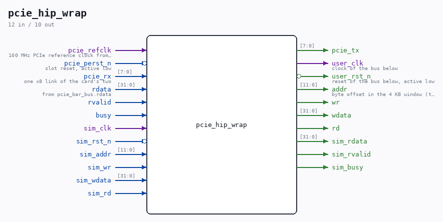
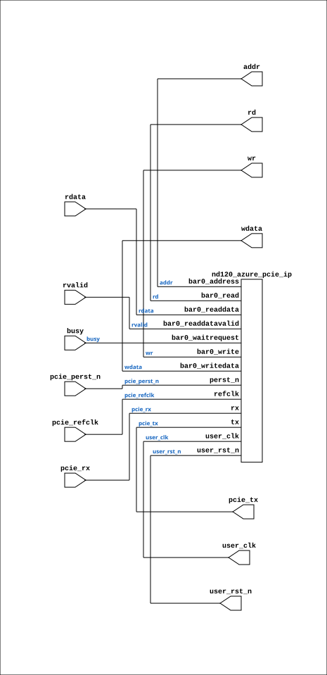

# pcie_hip_wrap

Source: `Verilog/fpga/azure-x930613/rtl/pcie_hip_wrap.v`

<!-- Generated by Verilog/tests/module_doc.py from the //! comments in the source. Do not edit by hand - edit the RTL comments and regenerate. -->

<!-- HIERARCHY-NAV:BEGIN - written by Verilog/tests/gen_hierarchy.py, do not edit -->

**Where it sits** (Azure): [nd120_azure_top](nd120_azure_top.md) > **pcie_hip_wrap**
- instance path: `HIP`

**Used in:** [nd120_azure_top](nd120_azure_top.md) (Azure)

**Contains:** `nd120_azure_pcie_ip` (vendor)

[Module hierarchy](../../../../HIERARCHY.md) - [All modules](../../../../MODULES.md)

<!-- HIERARCHY-NAV:END -->



<!-- SCHEMATIC:BEGIN - written by Verilog/tests/gen_schematics.py, do not edit -->

## Schematic

Drawn from the Verilog: the yosys netlist of the Azure card X930613 build, instance `HIP`. Sub-modules are boxes (click the picture to open it full size; there every sub-module box links to its page, and every wire shows its Verilog name).

[](pcie_hip_wrap.svg)

<!-- SCHEMATIC:END -->

## Ports

| Direction | Width | Name | Description |
|---|---|---|---|
| input | `1` | `pcie_refclk` | 100 MHz PCIe reference clock from the slot |
| input | `1` | `pcie_perst_n` *(active low)* | slot reset, active low |
| input | `[7:0]` | `pcie_rx` | one x8 link of the card's two |
| output | `[7:0]` | `pcie_tx` |  |
| output | `1` | `user_clk` | clock of the bus below |
| output | `1` | `user_rst_n` *(active low)* | reset of the bus below, active low |
| output | `[11:0]` | `addr` | byte offset in the 4 KB window (to pcie_bar_bus.addr) |
| output | `1` | `wr` |  |
| output | `[31:0]` | `wdata` |  |
| output | `1` | `rd` |  |
| input | `[31:0]` | `rdata` | from pcie_bar_bus.rdata |
| input | `1` | `rvalid` |  |
| input | `1` | `busy` |  |
| input | `1` | `sim_clk` |  |
| input | `1` | `sim_rst_n` *(active low)* |  |
| input | `[11:0]` | `sim_addr` |  |
| input | `1` | `sim_wr` |  |
| input | `[31:0]` | `sim_wdata` |  |
| input | `1` | `sim_rd` |  |
| output | `[31:0]` | `sim_rdata` |  |
| output | `1` | `sim_rvalid` |  |
| output | `1` | `sim_busy` |  |

## Verilog source

[`Verilog/fpga/azure-x930613/rtl/pcie_hip_wrap.v`](https://github.com/RetroCoreLabs/nd-120/blob/main/Verilog/fpga/azure-x930613/rtl/pcie_hip_wrap.v) on GitHub.

<details markdown="1">
<summary>Show the Verilog of pcie_hip_wrap (102 lines)</summary>

```verilog
//============================================================================
//! pcie_hip_wrap - the Stratix V PCIe hard block, behind a plain bus
//!
//! Board: Microsoft Azure FPGA card X930613-001 (Verilog/fpga/azure-x930613).
//!
//! Everything else on this board talks to the PC through ONE simple register
//! bus (the one pcie_bar_bus splits): addr / wr / wdata / rd, answered by
//! rdata / rvalid, with 'busy' holding the next access. This wrapper is the
//! only place that knows how that bus reaches the PCIe link
//! (docs/00-plan.md, step V3).
//!
//! TWO VERSIONS, chosen by a define:
//!
//!   ND120_AZURE_SIM_PCIE (simulation): no PCIe at all. The bus is brought
//!   out on sim_* ports so a testbench or the Verilator harness plays the
//!   PC; user_clk is sim_clk. This is the version every test here uses.
//!
//!   otherwise (the real card): the PCIe hard block, generated by Quartus
//!   Platform Designer as module nd120_azure_pcie_ip (Avalon-MM PCIe for
//!   Stratix V, Gen3 x8, one 4 KB BAR). THAT MODULE DOES NOT EXIST YET - it
//!   is made in step V5 - so a real-card build stops here with "module not
//!   found". That is deliberate: a missing PCIe block must fail the build,
//!   never build a card that silently has no console. The mapping it will
//!   need: its BAR master's address -> addr, write -> wr, writedata ->
//!   wdata, read -> rd, readdata/readdatavalid <- rdata/rvalid, waitrequest
//!   <- busy. The port names of nd120_azure_pcie_ip below are the PLAN for
//!   V5 and must be checked against the generated module.
//============================================================================

`default_nettype none

module pcie_hip_wrap (
    // ---- PCIe pins (unused in simulation) ----
    input  wire       pcie_refclk,   //! 100 MHz PCIe reference clock from the slot
    input  wire       pcie_perst_n,  //! slot reset, active low
    input  wire [7:0] pcie_rx,       //! one x8 link of the card's two
    output wire [7:0] pcie_tx,

    // ---- the user side ----
    output wire        user_clk,     //! clock of the bus below
    output wire        user_rst_n,   //! reset of the bus below, active low
    output wire [11:0] addr,         //! byte offset in the 4 KB window (to pcie_bar_bus.addr)
    output wire        wr,
    output wire [31:0] wdata,
    output wire        rd,
    input  wire [31:0] rdata,        //! from pcie_bar_bus.rdata
    input  wire        rvalid,
    input  wire        busy

`ifdef ND120_AZURE_SIM_PCIE
    ,
    // ---- simulation only: the PC side, played by the testbench ----
    input  wire        sim_clk,
    input  wire        sim_rst_n,
    input  wire [11:0] sim_addr,
    input  wire        sim_wr,
    input  wire [31:0] sim_wdata,
    input  wire        sim_rd,
    output wire [31:0] sim_rdata,
    output wire        sim_rvalid,
    output wire        sim_busy
`endif
);

`ifdef ND120_AZURE_SIM_PCIE

  assign user_clk   = sim_clk;
  assign user_rst_n = sim_rst_n;
  assign addr       = sim_addr;
  assign wr         = sim_wr;
  assign wdata      = sim_wdata;
  assign rd         = sim_rd;
  assign sim_rdata  = rdata;
  assign sim_rvalid = rvalid;
  assign sim_busy   = busy;
  assign pcie_tx    = 8'd0;

`else

  // The real card. See the header: this module is generated in V5 and the
  // port names here are the plan, not yet checked against it.
  nd120_azure_pcie_ip PCIE (
      .refclk           (pcie_refclk),
      .perst_n          (pcie_perst_n),
      .rx               (pcie_rx),
      .tx               (pcie_tx),
      .user_clk         (user_clk),
      .user_rst_n       (user_rst_n),
      .bar0_address     (addr),
      .bar0_write       (wr),
      .bar0_writedata   (wdata),
      .bar0_read        (rd),
      .bar0_readdata    (rdata),
      .bar0_readdatavalid(rvalid),
      .bar0_waitrequest (busy)
  );

`endif

endmodule

`default_nettype wire
```

</details>
